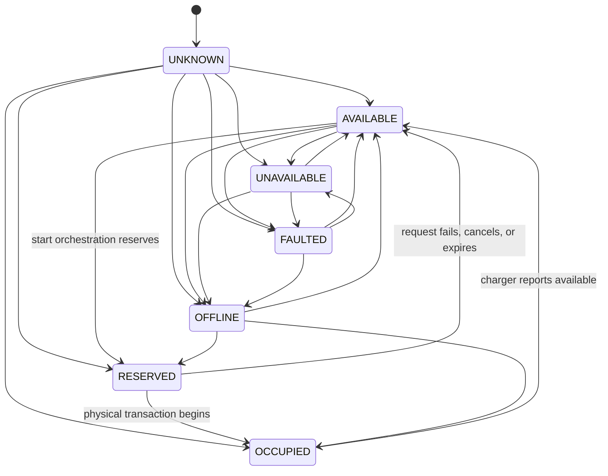

# Connector Availability State Machine

**Status:** Phase 7 implemented projection  
**Owner:** Charging; Assets retains equipment lifecycle ownership

Connector availability is a tenant-scoped, timestamped operational projection. It does not change commissioning, maintenance, or retirement state.

Remote start locks the latest projection and accepts only a fresh `AVAILABLE` connector. It creates a database-enforced single open reservation and transitions to `RESERVED` atomically. A physical transaction releases the orchestration reservation and transitions to `OCCUPIED`. A failed, cancelled, or expired pre-start workflow restores `AVAILABLE` only when the current projection is still `RESERVED` and no other unexpired reservation exists. Later charger facts always remain authoritative evidence.

Every change appends transition evidence and emits `charging.connector.status_changed.v1`. Staleness is calculated from UTC `observed_at` and `stale_after_seconds`; stale data must not be presented as live availability.

Live station presence now gates reads of connector availability: explicit disconnect or
expired last-message time means Offline; a new socket without a fresh connector report
means Unknown. Heartbeats preserve the last connector state reported on the current
connection. They do not cause an Available transition. See the
[OCPP projection rollout](ocpp-gateway.md#live-station-projection-2026-10-04).

## Mobile discovery display (FR-PUB-004, FR-CHG-003)

Display communication and readiness separately. `connection_status` is Online,
Offline, or Unknown; it must never be inferred from public visibility, publication,
or the presence of a station record. A published active station stays discoverable
while offline and before its connectors are configured.

The public v1 projection adds optional `operational_status`. It preserves the
existing availability aggregation but distinguishes Unavailable from Offline.
The original `availability` enum and offline filter retain their legacy behavior
for older clients. New mobile builds prefer `operational_status`, falling back to
`availability` against an older server. Connector readiness remains Available,
In use, Reserved, Unavailable, Fault reported, Offline, Stale, or Unknown.
The additive connector `reported_status` field preserves OCPP Preparing, Charging,
SuspendedEV, SuspendedEVSE and Finishing while the availability domain retains
Occupied. Admin and mobile display these as Preparing, Charging, Paused by vehicle,
Paused by charger and Finishing. OCPP 2.0.1 Occupied still displays In use; it does
not imply active energy transfer. A stale, disconnected or replaced connection
masks the detailed report. Heartbeats retain the current connection's last report,
and never fabricate Available or Charging.

Mobile cards, map markers and details identify the station by its name, with the
site shown separately. No configured connectors means "Connector details pending"
and unconfirmed readiness, not Available or an invented power rating. Last heard
is displayed independently of the connector observation time.

The mobile discovery controller invalidates cached communication and connector
signals after a failed refresh, when polling is paused or the phone is offline,
or when no successful fetch has completed for 15 seconds (checked on its five-second
foreground timer). Location and identity remain visible. Cached Offline also becomes
unconfirmed: a phone outage is not evidence that the charger itself disconnected.
Only a successful refresh restores live labels. This is bounded polling, not push.

The detailed status extension requires the additive
`2026_10_11_000001_add_reported_status_to_connector_statuses` migration before
deploying the consumer, query and admin changes. There is no historical backfill;
new StatusNotification messages populate the field. Old clients continue to use
availability. Deploy the platform projection and rebuild the mobile application. Public visibility still
requires an active/public station and active/public/published site with coordinates;
configure actual EVSEs and connectors through Assets before testing charging readiness.
Do not publish fabricated coordinates or infer connector ratings from a connection.
