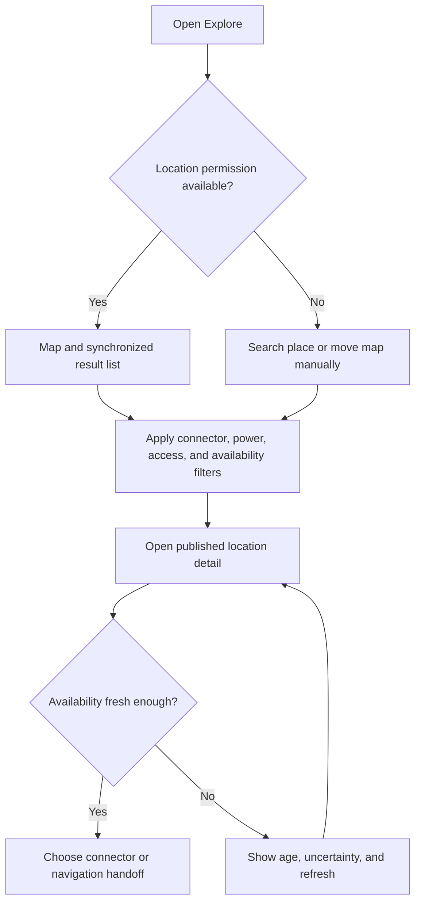
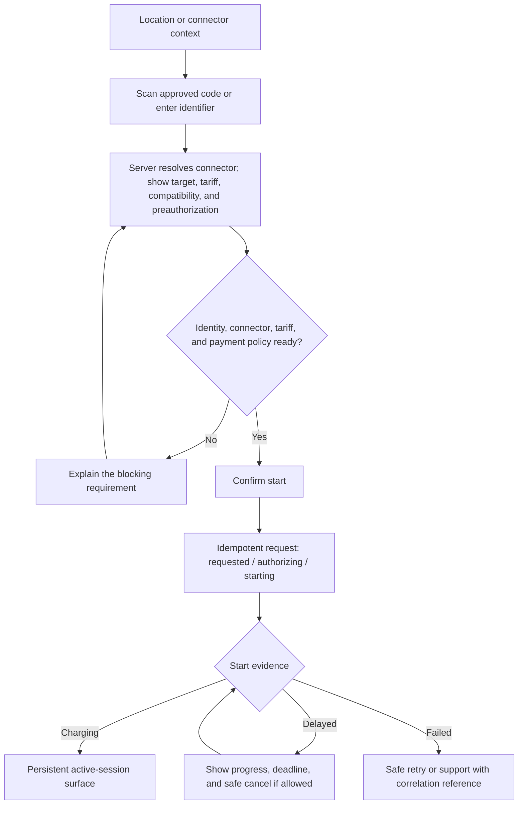
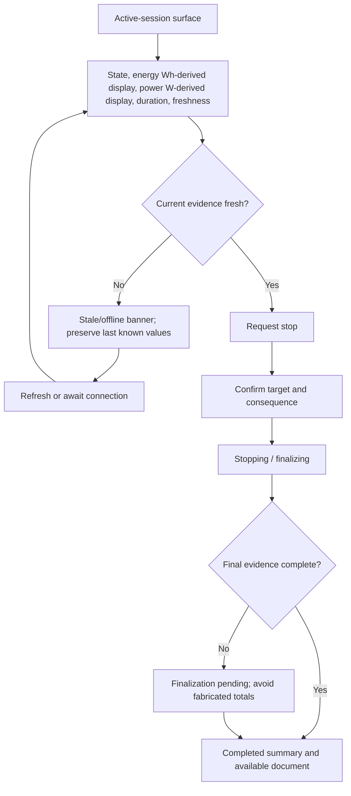

# Mobile User Flows

## Guardrails

The mobile app requires sign-in before browsing. Provider selection, reservation policy, roaming, tax terminology, and charger-specific recovery remain unresolved product decisions. Authenticated Phase 10 UI presents only server-supplied connector, tariff, preauthorization, payment-status, and document facts.

## App feedback

Action errors, warnings and confirmations use a centered Flutter dialog with a status icon, a short message and an explicit dismissal. When the server supplies a support reference, the dialog displays it as selectable text. Keep field validation at the relevant input and preserve persistent statuses and retry controls on their screens. A rejected charging start leaves the price review open so the driver can correct the issue and retry. Driver notices configured to appear on open use the same dialog and remain available in Updates after dismissal.

## Sign in before browsing

MOB-AUTH-001: A guest opens the EVCS welcome screen, including on first launch, with Sign in, Create account and sign-in help. Sign in opens the password form. Registration, password recovery and email-verification instructions remain accessible before authentication. There is no guest continuation or bottom navigation before authentication. Station, charging, KYC, favorites, wallet and session links pass through the same router guard; new screens are protected by default.

An unverified session remains on email verification, with resend, check status and change-account actions. Successful verified password sign-in and quick unlock open the Explore map. App setup is optional under Profile > App setup; neither a first-run carousel nor location/notification permission blocks entry. The existing native launch screen remains; the Flutter initialization state adds only a loading indicator, with no A01–A03 splash/welcome/onboarding sequence. Sign-out opens the welcome screen and removes the private back stack. An expired session or password fallback opens password sign-in. Direct-link targets are not retained through sign-in; the driver opens them again after authentication. Public website discovery and server authorization contracts are unchanged.

## PIN and fingerprint unlock

MOB-AUTH-002: After password sign-in and email verification, open **Account > PIN & fingerprint**. Enter and confirm a separate six-digit app PIN; optionally confirm fingerprint/Face ID through the phone's native prompt. Biometric enrollment is managed in phone settings. Setup is available on Android/iOS only.

When enrolled, reopening or returning shows the EVCS secure welcome with a private saved-account label, enabled biometric action and App PIN. Biometrics open the OS prompt directly; cancellation returns to PIN entry. The six masked positions auto-submit once after the sixth digit; the keypad also supports a physical keyboard. Inputs are disabled while verification is pending. Five incorrect PIN attempts remove local setup and require password sign-in. Server expiry, revocation and email verification remain authoritative; offline access stays locked. Password fallback and account switching confirm removal of local quick access before password sign-in. They do not stop a physical charging session. To change/remove a PIN, sign out from the security screen and sign in with the account password again. See [ADR-0020](../architecture/decisions/0020-mobile-pin-and-biometric-unlock.md).

The home map fills the available viewport. Search, Available/Fast/Compatible filters, authorized wallet access, list/map switch, notifications and location sit above it. The bottom bar contains Explore, Sessions, Scan, Wallet and Profile. List mode preserves the map instance and its viewport. Station signals and compatibility remain server-derived; stale, offline and unknown states retain their meaning. The initial view uses the configured map region. Location permission is requested contextually through Show my location or Nearest first.

MOB-DISC-UX-001: Explore keeps the current vehicle visible above the bottom navigation, beside the location control, including while a station preview is open. The card opens the vehicle picker; an empty garage opens vehicle management. Selection starts with the saved default, remains in memory for the current garage across tabs and reloads, and preselects the same vehicle in charging review. Choosing a vehicle does not rewrite the server garage default. An active Compatible filter follows the selected vehicle's recorded connector standards. Account changes and vehicle removal discard invalid selections. No vehicle position or model-specific image is inferred from the selected garage record.

## Guided identity verification

MOB-KYC-002: Explain the process before collecting evidence. Show five named stages: consent, personal details, document selection, photos/face check, and final review. The capture checklist identifies each required side, uploaded evidence, and the next unfinished capture.

Document capture uses an in-app camera with a rectangular outline, shaded surroundings, side-specific instructions and passport photo-page guidance. Selfie capture uses a face oval. These are positioning aids, not detection or approval indicators; images are not cropped to the outline. A quality checklist appears before upload, and Retake reopens the camera. Temporary evidence cleanup remains in place.

For optical verification, Open camera only opens the preview. The driver positions their face, then taps **I'm ready — start live check** to request the timed server challenge. An animated head demonstrates the current server-requested turn and stops on hold-still feedback. Blue scanning animation represents a frame being captured/sent/checked; it is not a face-detection result. Only a server `hold_still` response makes the oval green with “Position confirmed”; unclear-face feedback makes it amber. New requests reset green to blue, and stopping, errors or interruption clear confirmation. Color is paired with text and icons, and system reduced-motion settings disable the animations. Green confirms a requested position, not final identity approval. Error codes and bounded correlation references accompany retry guidance for support. Backgrounding stops the camera and requires a fresh start. The processor remains authoritative for actions, acceptance, expiry and completion; automatic approval policy is unchanged.

## Find a suitable connector

Map and list selection remain synchronized. Location denial does not block manual discovery. A stale marker cannot be presented as available.

## Authenticated charging start

MOB-CHG-UX-001: A selected connector is prepared directly; a scan or manually entered code resolves to the same single **Ready to charge** screen. It shows the server's connector, vehicle, tariff/tax/fees, budget and payer together. Vehicle and budget edits refresh the server quote in place. Do not add a second normal start-confirmation dialog. A complete rightward swipe authorizes the displayed reservation and calls the existing idempotent start operation once. A visible button alternative uses the same authorization gate. A compatibility mismatch requires explicit acknowledgement on this screen. Offline, unavailable connectors, failed quote refreshes and expired quotes disable start.

An accepted request opens the existing pending session; only charger transaction evidence marks charging active. The session view distinguishes estimated budget usage, confirmed readings, physical stopping, finalization and payment status. A completion/receipt summary uses actual server totals and supplied document links. Do not add a second payment or invent battery, power, remaining funds or final-cost values.

The live session groups energy delivered, estimated cost, power and elapsed time above budget progress. Energy is shown to the nearest Wh as three decimal places in kWh. The app refreshes the session automatically, shows the latest energy sample time, and retains the last readings between charger reports. The elapsed clock can tick independently while charging remains connected.

When idle pricing applies, **Ready to charge** displays the free unplug time and rate before the driver accepts the wallet budget. A charger-confirmed stop shows the server deadline and a countdown. After the deadline, the app explains that idle fees may apply until the charger confirms unplugging. The final charge summary itemizes the actual idle fee within the same budget.

The confirmation never guesses final price or charger behavior. Displayed tariff facts must come from the applicable versioned disclosure contract.

## Monitor and stop a session

Leaving the screen never hides a pending stop. Notification handoff and in-app status must lead back to the same session ULID.

## Payment action required

1. Explain that the payment provider requires action without exposing provider secrets or raw card data.
2. Hand off only to an approved hosted/tokenized collection surface.
3. Preserve the payment/session context while the app backgrounds.
4. On return, app resume or push retrieves verified provider state rather than trusting the redirect alone.
5. Show pending or unknown outcomes as pending; do not offer a duplicate attempt until reconciliation rules permit it.

## Review history and get support

1. Activity defaults to the active or most recent session.
2. History distinguishes provisional, final, corrected, and review-required records.
3. A session detail exposes canonical facts, presented units, applicable documents, and support action.
4. Opening support carries only approved public references and a user-authored description.
5. The user can return to the source session without losing a draft support message.

## Offline and interrupted flows

- Cached discovery data shows its age and does not claim live availability.
- Start and stop actions that require network confirmation are disabled with a reason; the app must not queue a duplicate financial or charging command silently.
- Draft non-sensitive form input may survive process interruption according to an approved retention policy.
- Authentication expiry returns through a resumable re-authentication boundary when safe.
- Deep-link, notification, another-device sign-in, and app-restart recovery resolve the latest authoritative state by public ULID.
- Persist only the account-scoped session pointer needed to recover; never persist a tariff, metering, document, or payment projection as authoritative.

## Navigation flow

The four bottom destinations are Explore, Activity, Wallet, and Account. A centered active-session banner appears above the bar when applicable. Back behavior returns through the local task stack; switching tabs preserves only safe, bounded UI state.

## Validation needed

Test with drivers who use assistive technology, low-connectivity environments, unfamiliar charger hardware, and multiple payment outcomes. Navigation provider, tariff disclosure content, receipt terminology, and push provider remain open.

## Feature review update, 2026-10-08

Signup now collects separate names, date of birth (minimum 18), and a plate or Plate pending. See [staging acceptance](../runbooks/mobile-feature-review-testing.md) and [ADR 0021](../architecture/decisions/0021-driver-onboarding-and-server-garages.md) for account garages, versioned signup, KYC guidance, vehicle filtering, connector status, and deferred payment/queue work.

### Wallet / QR Ph top-up

Wallet shows available/reserved amounts, activity and resumable top-up requests. Create uses an exact PHP amount and stable retry ULID. The detail screen polls backend confirmation, hides expired QR codes, and never accepts a client assertion of payment. Simulated mode clearly labels funds as test-only and has no payable QR. For a live pending QR, the driver can save a labelled QR image to Photos, then open a bank or e-wallet app that supports importing a QR image. The saved image includes the amount and expiry; saving or opening another app never confirms payment. Android offers GCash and Maya launch shortcuts after saving; these open the installed app's home screen and do not prefill or authorize a payment. Other banks and iOS users open their preferred app manually. On return, the top-up refreshes and remains pending until verified AUB confirmation. AUB's QR Ph `code_url` is EMV QR content, not a universal wallet-app deep link. A direct wallet handoff requires a separately documented and approved provider integration.

The top-up form displays minimum and maximum amounts returned by the wallet API and validates against the same values before submission; the backend enforces those limits again. No peso amount is built into the app. Simulated top-ups are available only in local builds with the simulated-payments flag enabled. Staging and production driver builds do not offer a test top-up action even if the server is accidentally set to simulated mode; they still label any returned simulated balance as test funds.
